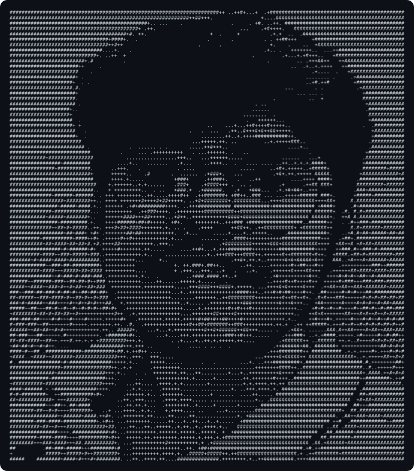

<pre>
  ____           _          _   _           _     
 / ___| ___  ___| | ___   _| \ | | __ _  __| |___ 
| |  _ / _ \/ _ \ |/ / | | |  \| |/ _` |/ _` / __|
| |_| |  __/  __/   &lt;| |_| | |\  | (_| | (_| \__ \
 \____|\___|\___|_|\_\\__, |_| \_|\__,_|\__,_|___/
                      |___/                       

geekynads@github
-----------------------------------------
name     : Likhit Midithana
role     : Founder @ <a href="https://dealfeed.tech">DealFeed</a>
status   : DealFeed waitlist is open
past     : Co-Founder @ Verseoid (closed)
work     : SWE Intern @ Akiya 2.0 (Tokyo)
study    : B.E. CSE @ DSCE (2025-2029)
location : Bengaluru, India
focus    : Builder . Open Source . AI
learning : Advanced JavaScript &amp; TypeScript
site     : <a href="https://likhitgeekynads.vercel.app/">likhitgeekynads.vercel.app</a>
-----------------------------------------
</pre>

 

<pre>
 ___       _    _   _         _   _____               
/ __| __ _| |_ (_) | |_  __ _(_) |_   _|__ _ _ __ _   
\__ \/ _` | ' \| | | ' \/ _` | |   | |/ -_) '_/ _` |_ 
|___/\__,_|_||_|_| |_||_\__,_|_|   |_|\___|_| \__,_(_)
</pre>

